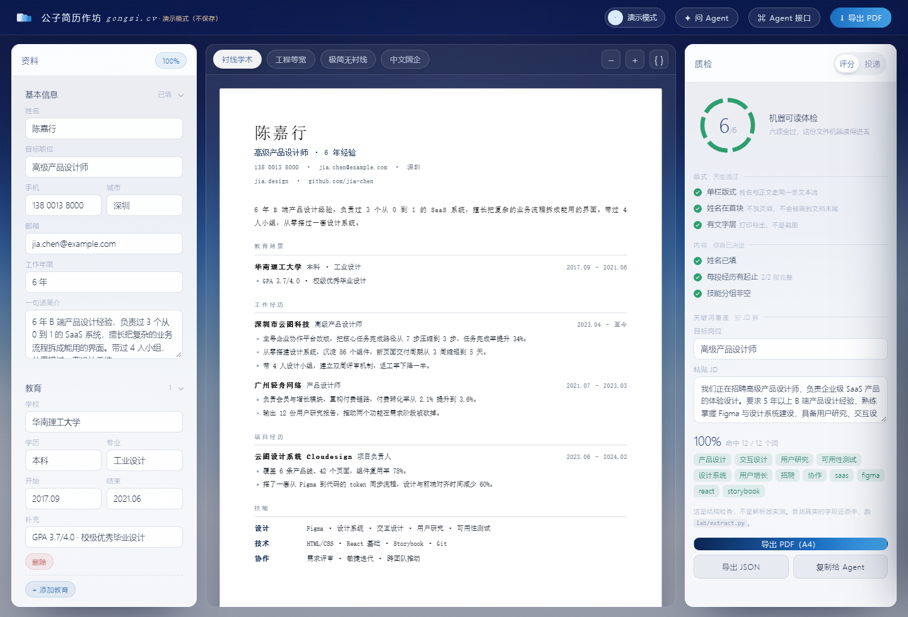
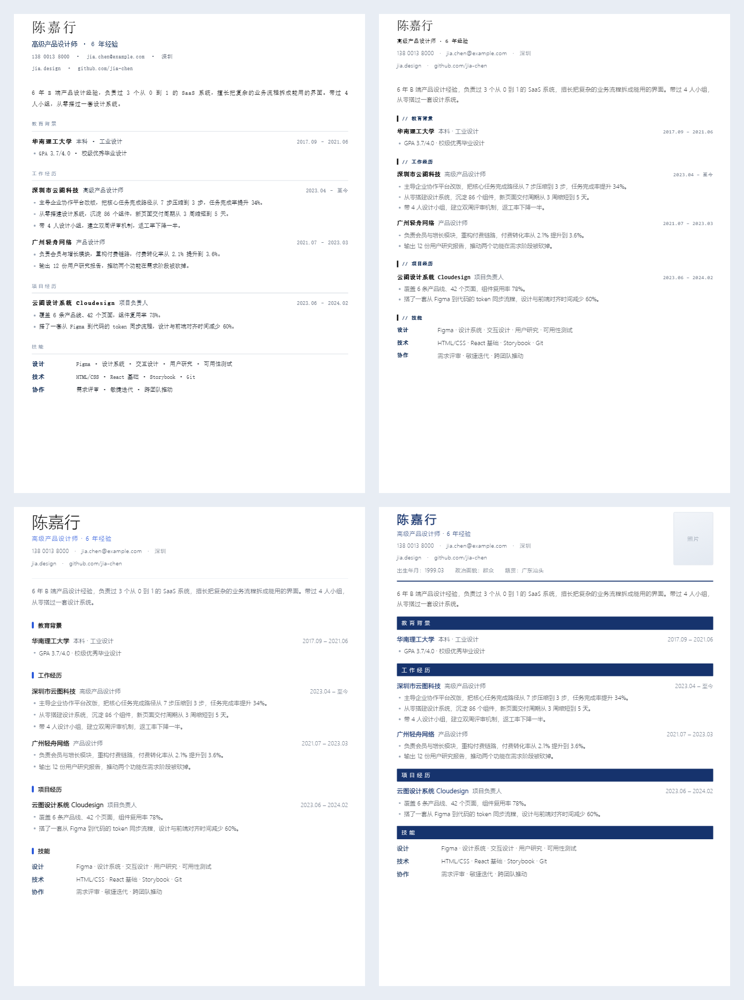

# 公子简历作坊

一份数据，四套版式，六道体检。登录后存在云端，手机电脑打开是同一份。

**线上地址**：https://gongzi-cv.app.workbuddy.host



## 为什么是这么个东西

先把五个开源简历工具拆开看了一遍 —— [LapisCV](https://github.com/BingyanStudio/LapisCV)、[RenderCV](https://github.com/rendercv/rendercv)、[Reactive Resume](https://github.com/reactive-resume/reactive-resume)、[Resume-Matcher](https://github.com/srbhr/Resume-Matcher)、[tw93/Kami](https://github.com/tw93/Kami)。它们各管一段：模板、排版、产品、JD 匹配、交付形态。中间空着一件事：**导出的那份 PDF，机器到底读不读得懂。**

所以先造了一把尺子 —— 51 份语料、3 个解析器、98 条测量 —— 量出六种死法，再按这六条做工具。

| 版式 | 还原率 | 字段定位 | 顺序正确 |
|---|--:|--:|--:|
| 单栏纯文本 | 100% | 100% | 100% |
| 双栏侧边栏 | 100% | 100% | **0%** |
| 姓名放页眉 | 100% | 62% | 50% |
| 图片型（无文字层） | **0%** | 0% | 0% |

完整表格、复现脚本和事故现场在 [`lab/`](lab/)。

## 用起来

打开线上地址，登录，开始写。

- **微信登录**，或者**邮箱验证码**，不需要记密码
- 左边填资料，中间实时变，右边体检
- 顶部四个胶囊换版式：衬线学术 / 工程等宽 / 极简无衬线 / 中文国企
- 每次改动自动存云端，顶栏头像变黄表示正在存
- 「导出 PDF」走浏览器打印，A4，页边距选「无」

不想登录也能点「先看看」，进演示模式 —— 顶栏会写明「演示模式（不保存）」，数据不会存。

## 六项体检

不是拍脑袋定的，是 `lab/` 量出来的六种死法。

**版式三项**（这个渲染器天生满足）

1. **单栏** —— 双栏的文本流是逐行跳栏交错的，还原率 100% 但顺序 0%
2. **姓名在首块** —— 放页眉会被画到文档最后一行（14 行的文档，名字在第 13 行）
3. **有文字层** —— 图片型 PDF 抽取结果是 0 字符

**内容三项**（你自己决定）

4. 姓名已填
5. 每段经历有起止
6. 技能分组非空

> 这六项是**结构检查**，不是解析器实测。要真实的字段还原率，跑 `lab/extract.py`。

## 四套版式



同一份数据，四种排版。中文国企那套带照片位、出生年月、政治面貌、籍贯。

## 架构

```
index.html        前端（单文件，原生 JS，无构建）
                  云 SDK 从 CDN 加载：@tencent-ai/workbuddy-cloud-sdk
mcp-server.mjs    给 Agent 用的 MCP 服务器（本地，零依赖）
lab/              测量语料与脚本
```

后端是 WorkBuddy 云服务：

- **Auth** —— 微信 OAuth（走 Relay）+ 邮箱验证码
- **Database** —— `resumes` 表，一行一个用户，`data` 是 JSONB
- **RLS** —— `owner_id = auth.uid()`，SELECT / INSERT / UPDATE 三条策略，前端从不发送 `owner_id`

## 让 Agent 调

本地跑一个 MCP 服务器，读写的是同一套数据结构：

```json
{
  "mcpServers": {
    "gongzi-cv": {
      "command": "node",
      "args": ["<你的路径>/cv-studio/mcp-server.mjs"]
    }
  }
}
```

| 工具 | 干什么 |
|---|---|
| `profile_get` | 读全部资料 |
| `profile_set` | 写，深合并，只传要改的 |
| `resume_check` | 六项体检 + 关键词覆盖 |
| `resume_export` | 出 pdf / html / md / json |
| `track_add` | 记一次投递 |
| `track_stats` | 回复率统计，样本 < 8 会明确警告 |

自测：`node test-mcp.mjs`，14 项。

## 边界

- **微信登录只在发布域名上有效**，本地 `file://` 和预览链接会被 Relay 拒绝 —— 这是平台限制，不是 bug。
- **MCP 服务器连的是本地 JSON 文件**，云端数据要手动导出 JSON 再喂给它。还没做直连。
- **关键词词典**硬编码 70 来个词，覆盖产品 / 技术 / 财务 / 销售 / HR，冷门行业会漏。
- **导出用浏览器打印**，不是 Typst。实测单栏 + 打印这条链路 100% 可读，所以先没换。
- **没有版本历史**。改了就改了。

## lab 里怎么复现

```bash
cd lab
python gen_corpus.py     # 生成 51 份对抗性语料（需要 Chrome）
python extract.py        # 三个解析器跑一遍
python score.py          # 出表
```

语料内容是合成的（虚构人名公司），**版式和 PDF 生成链路是真的**。

## License

[MIT](LICENSE)
