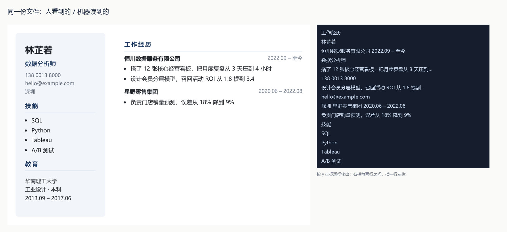

# 第一步 · 造一把尺子

**结论先说：这把尺子在对照组上是干净的，在实验组上挂得很有规律——而且挂的位置，跟"简历好不好看"没有关系。**

---

## 一、这张表怎么读

三个指标，各管一件事，不能混着看：

| 指标 | 问的问题 | 谁的责任 |
|---|---|---|
| **还原率** | 真值那串字，在抽取文本里连续出现吗？ | 文件本身。字被吃掉、拆开、变成图，谁也救不了 |
| **定位（笨）** | 一个规矩的读取器（只看前 20 行、不解标签）能不能把它放对槽位？ | 版式 + 读取器的下限 |
| **定位（聪明）** | 清洗过 `(cid:N)`、图标字符、`姓名` 标签前缀、去掉字间距之后，还能不能？ | 版式 + 读取器的上限 |
| **顺序** | 姓名 → 工作经历 → 技能，先后顺序保住了吗？ | 纯版式问题，两个读取器都一样 |

**为什么要拆成"笨/聪明"两列**：如果只有一列，我永远分不清是文件坏了，还是我的正则太笨。两列一对比——差距大的是我笨（表格：50→80），差距不变的是文件真坏了（页眉：62→62，一个字都没救回来）。

**为什么先要有对照组**：单栏、衬线、Word、照片、两页这五类各 4 份，跑出来全是 100/100/100。如果它们也挂，那说明尺子有问题，后面所有数字都不用看。

---

## 二、数据从哪来（这一节决定这张表算不算数）

**我拿不到 50 份真人投过的简历。** 那是别人的隐私数据，我也不能凭空造出"投了有没有回音"这个标签。所以做了两件事：

1. **把尺子造好**，任何人把真简历放进 `corpus/real/` + 一份标注表，跑一条命令就出同样的表（见第七节）。
2. **先造了 51 份对抗性样本**，用来验证尺子有没有分辨力。每一份对应一种真实世界里确实存在的做法，内容是我编的（虚构人名/公司），**版式和 PDF 生成链路是真的**。

12 种版式 × 3–5 份，共 51 份、98 条测量记录（PDF 各跑两个解析器，DOCX 跑 python-docx）。

| 版式 | 份数 | 用的是哪条生成链路 |
|---|--:|---|
| 单栏纯文本 | 4 | Chromium 打印（≈ 网页简历工具、Canva 导出） |
| 衬线紧凑 | 4 | Chromium，Georgia 衬线、紧行距（≈ LaTeX 风） |
| Word 文档 | 4 | python-docx 直接生成 |
| 照片与色块 | 4 | Chromium，照片位 + 色带 |
| 两页长简历 | 4 | Chromium，内容溢出到第 2 页 |
| 中文国企表格 | 5 | Chromium，照片位 + 政治面貌 + 蓝底章节条 |
| 表格布局 | 5 | Chromium，`<table>` 两列（≈ 大量国产模板） |
| 图标字体联系方式 | 5 | Chromium，联系方式前插私用区图标字符 |
| 姓名放页眉 | 4 | Chromium，`position:fixed` 页眉 |
| 绝对定位 | 4 | reportlab 逐条 `drawString`（≈ 设计工具导出） |
| 双栏侧边栏 | 5 | Chromium 左右两栏 |
| 图片型 | 3 | 渲染成 150dpi 位图再包成 PDF（≈ 扫描件、截图粘贴） |

**必须说清楚的三条限制**（不说就是不老实）：

- **没有结果标签**，所以算不出"这样写会不会被约面试"。这张表只说"机器能不能读懂"，不说"读懂了会不会要你"。
- **51 份、每类 3–5 份，置信区间很宽。** 下面的百分比是方向，不是精确值。86% 不是"准确率 86%"。
- **没有真实 Word 导出**（这台机器没有 LibreOffice），DOCX 是程序生成的，缺了 Word 的文本框、艺术字这些真实花招。

---

## 三、主表

### 表 1 · 按版式（n = 文档数）

| 版式 | n | 还原率 | 定位（笨读取器） | 定位（聪明读取器） | 顺序正确 |
|---|--:|--:|--:|--:|--:|
| 单栏纯文本（基线） | 4 | 100% | 100% | 100% | 100% |
| 衬线紧凑（LaTeX 风） | 4 | 100% | 100% | 100% | 100% |
| Word 文档 | 4 | 100% | 100% | 100% | 100% |
| 照片与色块 | 4 | 100% | 100% | 100% | 100% |
| 两页长简历 | 4 | 100% | 100% | 100% | 100% |
| 中文国企表格 | 5 | 100% | 86% | 86% | 100% |
| 表格布局 | 5 | 100% | 50% | 80% | 100% |
| 图标字体联系方式 | 5 | 100% | 80% | 90% | 100% |
| 姓名放页眉 | 4 | 100% | 62% | 62% | 50% |
| 绝对定位（设计工具） | 4 | 100% | 92% | 92% | 50% |
| 双栏侧边栏 | 5 | 100% | 100% | 100% | 0% |
| 图片型（无文字层） | 3 | 0% | 0% | 0% | 0% |

### 表 2 · 按字段（只看失败集中的版式，乖/聪 = 两种读取器）

| 版式 | 姓名 | 最近公司 | 职位 | 起止时间 | 技能 |
|---|--:|--:|--:|--:|--:|
| 表格布局 | 0 / 100 | 0 / 0 | 50 / 100 | 100 / 100 | 100 / 100 |
| 图标字体联系方式 | 100 / 100 | 0 / 50 | 100 / 100 | 100 / 100 | 100 / 100 |
| 中文国企表格 | 40 / 40 | 90 / 90 | 100 / 100 | 100 / 100 | 100 / 100 |
| 姓名放页眉 | 12 / 12 | 100 / 100 | 0 / 0 | 100 / 100 | 100 / 100 |
| 绝对定位（设计工具） | 62 / 62 | 100 / 100 | 100 / 100 | 100 / 100 | 100 / 100 |

### 表 3 · 按解析器

| 解析器 | 记录数 | 还原率 | 定位率 | 顺序正确 |
|---|--:|--:|--:|--:|
| pdfplumber | 47 | 94% | 79% | 83% |
| pymupdf | 47 | 94% | 83% | 66% |
| python-docx | 4 | 100% | 100% | 100% |

---

## 四、五个具体发现（都附原文证据）

### 1. 图片型：唯一的"必死"

3 份全部 **0 字符**。没有文字层，任何解析器都读不出一个字。这不是"分数低"，是"不存在"。

> 现实里对应：扫描件、手机拍照、把简历截图粘进 Word 再导出、部分设计工具默认导出图片型 PDF。

### 2. 双栏：内容一个字没丢，顺序全军覆没

还原 100%、定位 100%、**顺序 0%**。这是全表最反直觉的一行——所有字段都还在，但文本流是这样的：

```
工作经历
林芷若
恒川数据服务有限公司 2022.09 – 至今
数据分析师
搭了 12 张核心经营看板，把月度复盘从 3 天压到 4 小时
138 0013 8000          ← 左栏的联系方式，插进了右栏两行之间
设计会员分层模型，召回活动 ROI 从 1.8 提到 3.4
hello@example.com      ← 又插一次
深圳 星野零售集团 2020.06 – 2022.08
```

**不是"顺序不同"，是逐行跳栏。** 人看到的是两栏，机器看到的是被切开的一句话。而且两个解析器都救不回来——因为 PDF 内部本来就是这个顺序，没有"栏"这个概念。

> 这条把一句流传很广的流言（"ATS 读不懂双栏"）变成了可测量的东西：**读得懂每个字，读不懂谁属于谁。**



### 3. 姓名放页眉：你的名字被画到了文档末尾

14 行的文档，姓名出现在第 13 行。

```
工作经历
锐驰工业设备有限公司
2021.06 – 至今
...
郑一鸣            ← 第 13 行
```

`position:fixed` 的元素在打印时被最后绘制，于是整段内容流被追到末尾。还原率 100%（它在文件里），顺序 50%，定位 12%。

> 现实里对应：Word 的页眉、很多模板的"每页顶部显示姓名"。**这是最容易中招、也最难自己发现的一条**——你打开 PDF 看，姓名明明在右上角。

### 4. 表格：字段边界被抹平了

```
姓名 周敬亭
工作经历1 蓝湾网络技术有限公司（2021.03 – 至今）
```

标签、序号、公司、时间全挤在同一行。聪明读取器能把姓名从 0 救回 100，但**公司这项还是 0/0**——因为要剥掉"工作经历1"这个前缀，你得为每一种模板单独写一条规则。

> 这就是"每套模板都要单独适配"的量化版本：不是不能适配，是适配成本随模板数量线性增长。

### 5. 图标字体：往文本层里倒垃圾

```
(cid:0) 138 0013 8000 (cid:0) hello@example.com
(cid:0) 中衡会计师事务所 2020.05 – 至今
```

图标没有 Unicode 映射，抽出来就是 `(cid:0)`。公司名被前缀污染，笨 0% / 聪明 50%。

---

## 五、两个"元发现"（比上面五条更重要）

### A. 不同的解析器，对同一份文件给出的顺序不一样

47 份 PDF 里，有 **8 份**两个开源解析器判定不一致（pdfplumber 顺序 83% vs pymupdf 66%）。

这意味着：**"这个 PDF 的阅读顺序对不对"没有唯一答案，取决于谁来读。**

直接后果——第四步的黄金文件不能只存一份文本。**必须按解析器分开存**，否则你会为了讨好一个解析器而改坏另一个，而且永远发现不了。

### B. 中文和英文在字距上表现相反

中文名即使加了 `letter-spacing:.18em`，抽出来仍是完整的"陈嘉行"；英文名同样的字距会被拆成：

```
M a r i a G o n z a l e z
```

**直接命中我们自己的产品**：`cv-studio` 的中文国企皮肤给姓名加了 `letter-spacing:.18em`。中文用户没事，英文用户会碎。

---

## 六、对 cv(studio) 的四条判决

| # | 判决 | 依据 |
|---|---|---|
| 1 | **浏览器打印不是原罪。** 单栏 100%，而这正是现在导出走的链路（Chromium print-to-pdf） | 表 1 前 5 行全 100% |
| 2 | **四套皮肤里没有双栏，是运气好。** 以后谁提"加个左侧栏"，先看表 1 第 11 行 | 双栏顺序 0% |
| 3 | **照片位的"照片"两个字已经被删掉**（改用空白占位）。语料里 cngov-01 就是被这俩字顶成了"姓名" | `cngov-01` 抽取文本第 1 行 |
| 4 | **中文国企皮肤的 `.18em` 字距，对英文名要单独归零** | 发现 B |

另外，现在界面上那个 93 分（关键词覆盖）**测不到以上任何一条**——它算的是"词在不在"，而真正让简历挂掉的是"顺序对不对""有没有文字层"。这正是第二步要把它删掉的理由：**它会给你一种"我检查过了"的错觉。**

---

## 七、怎么把真简历接进来

```bash
# 1. 丢文件
cp ~/resumes/*.pdf  corpus/real/

# 2. 填标注（一份文件一行，可只填知道的字段）
#    id 用文件名去掉扩展名
cat > labels.csv <<'EOF'
id,name,company,title,dates,skills
zhang_san_2024,张三,某科技有限公司,后端工程师,2021.03 – 至今|2018.07 – 2021.02,Java|MySQL
EOF

# 3. 跑
python build_real.py      # 把 labels.csv 并进 ground_truth.json
python extract.py         # 同样的规则，同样的表
python score.py
```

**这一步我建议你自己做，或者把脱敏后的文件给我。** 因为只有你手上才有"投过、有回音"的那批简历，而那才是唯一能算出预测效度的数据。

---

## 八、下一步

按原计划，第二步是把界面上的 40/20/15/15/10 删掉，换成今天测出来的这两个有定义的量（还原率 + 顺序）。现在已经有实现代码了，直接复用 `extract.py` 就行。

但**在换之前，有一个决定要你拍**：真简历要不要接。因为如果只有合成语料，这套指标只能告诉你"版式 X 会挂"，不能告诉你"改了之后回复率会不会变"。前者今晚就有了，后者必须有真数据。

---

*所有原始数据：`results/raw.csv`（98 条）、`results/table.md`、`results/text/`（每份文档的抽取原文，可以直接看事故现场）。*
